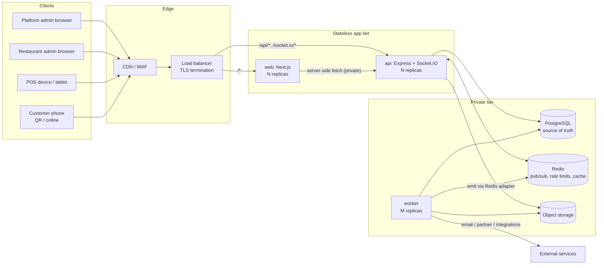

# A. High-level architecture

## Components



| Component          | Role                                                                                                                                                               | State                           |
| ------------------ | ------------------------------------------------------------------------------------------------------------------------------------------------------------------ | ------------------------------- |
| **web**            | Next.js App Router. Renders all UI surfaces (platform admin, restaurant admin, POS, QR/online ordering). Resolves brand per host. No business rules, no DB access. | None (stateless)                |
| **api**            | Express modular monolith. All business logic, authentication, authorization, entitlements, tenant scoping. Hosts Socket.IO.                                        | None in memory (stateless)      |
| **worker**         | Outbox relay, durable jobs, schedules, notifications, reports, partner reconciliation, integrations.                                                               | None in memory                  |
| **PostgreSQL**     | Authoritative store for everything that matters: tenants, menus, orders, payments, subscriptions, entitlements, audit, outbox, jobs.                               | Durable                         |
| **Redis**          | Socket.IO cross-instance fan-out, distributed rate-limit counters, selected caches (for example entitlement snapshots, public brand).                              | Disposable. Rebuildable from PG |
| **Object storage** | Brand assets, menu images, report exports. Accessed through signed URLs.                                                                                           | Durable                         |

## Routing contract (same origin)

The browser talks to **one origin per brand domain**. The load balancer routes `/api/*` and `/socket.io/*`
to the API and everything else to Next.js. Consequences:

- Session cookies are first-party, `HttpOnly`, `Secure`, `SameSite=Lax`, and host-scoped (works with custom brand domains).
- No CORS needed for the main application. CORS stays deny-by-default.
- Next.js server components call the API over the private network (`WEB_INTERNAL_API_URL`), forwarding the user's cookie.

## Typical flows

### 1. Staff places a POS order (write path)

```
POS -> POST /api/v1/locations/:locationId/orders   (Idempotency-Key header, session cookie, CSRF token)
 api: authenticate (identity) -> AccessContext (authorization: tenant from membership, location allowed?)
      -> authorize('orders.create') -> entitlements.requireFeature(location, 'pos')
      -> BEGIN; set tenant context (RLS); idempotency check; load menu prices; compute totals;
         insert order + items + outbox('order.created'); COMMIT
 <- 201 with authoritative order (server-calculated totals)
worker: outbox relay picks 'order.created' -> emits to room loc:{locationId} via Redis adapter
other devices in that location receive the event -> refetch or apply -> UI consistent
```

### 2. Customer QR order

```
Phone scans QR (/t/{token}) -> web resolves brand by host -> api validates table token
 -> anonymous customer session bound to ONE table session -> requireFeature('qr_ordering')
 -> customer submits cart (product ids + qty only) -> orders module computes totals -> same outbox path
```

### 3. Platform admin changes a restaurant's plan

```
platform admin (MFA, recent re-auth) -> preview change -> confirm
 -> subscriptions: new subscription period / scheduled change + audit + outbox('subscription.changed')
 -> worker: invalidate entitlement snapshot cache, emit 'entitlements.changed' to tenant rooms
 -> devices refetch their entitlement snapshot (UI only; the server enforces on every request anyway)
```

## What is deliberately absent

No microservices, Kafka, Kubernetes, search engines, event sourcing or per-tenant databases. Each would add
operational cost without a current requirement. The module boundaries keep extraction possible later if a
measured need appears (for example extracting reporting to read replicas).
