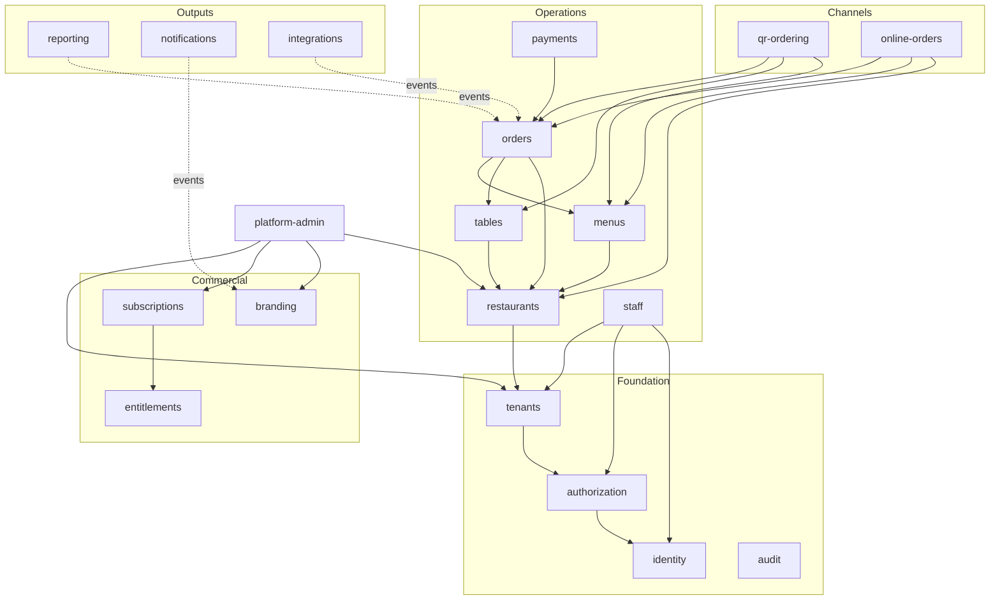

# B. Module boundaries

## Style

A **modular monolith**: one deployable API, internally split into business modules with explicit public
interfaces. Pragmatic DDD (bounded contexts, invariants in the domain layer) and Clean Architecture
(dependencies point inward), applied only where they pay for themselves.

Per-module responsibilities are documented in each module's README under `apps/api/src/modules/<name>/`.
The index is [apps/api/src/modules/README.md](../../apps/api/src/modules/README.md).

## Layers inside a module

```
http/            -> application/      -> domain/
(Express, Zod)      (use cases, tx,      (pure rules,
                     authZ, entitlements, state machines)
                     outbox)
                         |
                         v
                  infrastructure/  (Kysely queries, adapters; implements what application needs)
```

| Layer             | May depend on                                                                                         | Must not depend on                                              |
| ----------------- | ----------------------------------------------------------------------------------------------------- | --------------------------------------------------------------- |
| `http/`           | its `application/`, `shared/`, contracts                                                              | other modules' internals, DB                                    |
| `application/`    | its `domain/`, its `infrastructure/`, other modules' `index.ts`, `infrastructure/database` + `events` | Express request/response objects                                |
| `domain/`         | nothing framework-specific (plain TypeScript)                                                         | Express, pg, Kysely, Redis, Socket.IO, Pino (**lint-enforced**) |
| `infrastructure/` | Kysely, pg, external SDKs, its `domain/` types                                                        | other modules' tables                                           |

We do **not** require an interface for every repository. A use case may call Kysely-backed functions
in its own `infrastructure/` directly. Introduce an interface (port) only where there are multiple
implementations or a real test seam is needed (payment providers, external integrations, clock, ID generation).

## Dependency graph (allowed directions)



Arrows mean "calls the public API of". Every operational module also depends on `authorization`,
`entitlements` and `audit` (omitted for readability). Dotted arrows mean the module reacts to events and does not call synchronously.

## Communication rules

1. **Synchronous:** call another module's exported application service from `modules/<x>/index.ts`.
   Use this when the caller needs an answer now (for example `orders` asks `menus` for current prices).
2. **Asynchronous:** write a domain event to the **outbox** in the same transaction; the worker delivers it
   to subscribers (jobs, real-time). Use this for side effects (notifications, reports, cache invalidation).
3. **Never** query another module's tables, import its `infrastructure/` or `domain/` internals, or share mutable state.
4. **Transactions** are owned by the application-layer use case that started them. A synchronous call
   into another module can accept the caller's transaction handle (`tx`) when atomicity across modules is
   required (for example order plus table-session update). This is explicit in the function signature.
5. **No cycles.** If two modules need each other, the dependency usually belongs in a third module or an event.

## Cross-cutting placement

| Concern                      | Location                                                    |
| ---------------------------- | ----------------------------------------------------------- |
| Request authentication       | `identity` (exposed as middleware via `app/`)               |
| `AccessContext` and policies | `authorization`                                             |
| Feature/limit enforcement    | `entitlements`                                              |
| Tenant DB context (RLS)      | `infrastructure/database`                                   |
| Outbox writes                | `infrastructure/events`                                     |
| WebSocket rooms              | `infrastructure/websocket`                                  |
| Errors to HTTP mapping       | `shared/errors` + `shared/middleware`                       |
| Wiring                       | `app/` (composition root, plain functions, no DI container) |

## Frontend mapping

`apps/web/src/features/<area>` mirrors the API modules. The web app never contains business rules that
the API does not also enforce. Restaurant Administration and Platform Administration are **UI surfaces**
(route groups), composed from many API modules. They are not backend modules, except for the
`platform-admin` orchestration module.

## Excluded from the initial release

Kitchen order receiving, kitchen display screens and kitchen preparation workflows. The outbox event
stream (`order.created`, …) is the natural integration point if a `kitchen` module is approved later.
No placeholder module is created for it.
