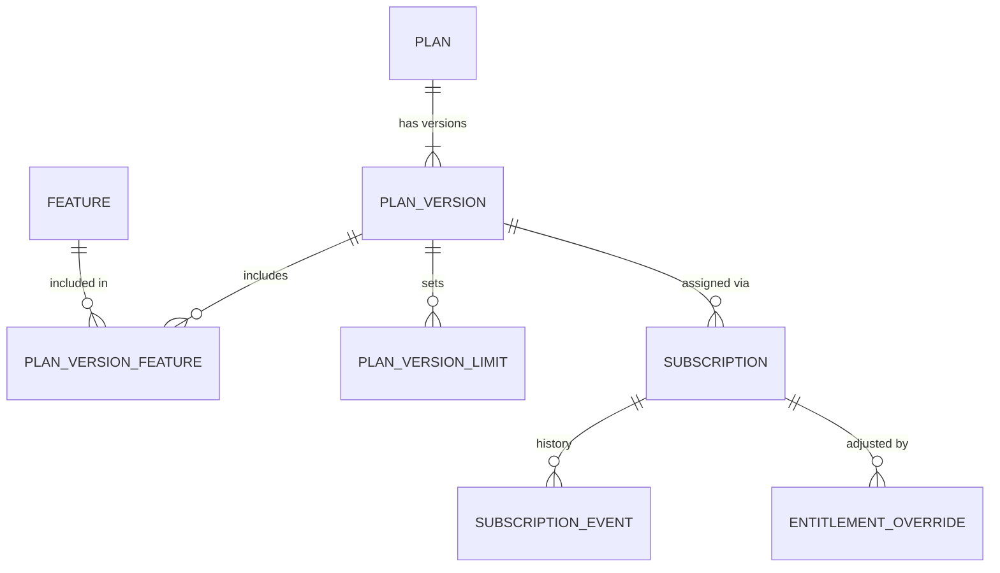

# D. Subscription entitlements

> Package names (Basic, Standard, Premium, Platinum), their feature inclusions, limits and prices are
> **not final**. Earlier commercial drafts differ. The design makes all of that **data**, so the final
> matrix can be configured without code changes.

## Principles

1. **One implementation per feature.** There is one POS module, used by every plan that includes `pos`. No `PremiumPOS`.
2. **Features are code; availability is data.** A feature exists only if it is implemented and registered
   in the code feature registry. Database configuration decides _who gets it_. A DB toggle can never
   activate an unimplemented feature.
3. **No plan-name checks in code.** Code asks `requireFeature(…, "online_ordering")`, never `if (plan === "premium")`.
4. **Server-side enforcement everywhere:** HTTP, WebSocket client events, background jobs, integrations.
5. **Entitlement ≠ permission.** Both must pass. Subscribing to online ordering does not let a cashier edit delivery settings.
6. **Subscription commerce ≠ restaurant payments ≠ developer-fee reconciliation.** Three separate domains.

## Concepts and data model (planned, not migrated)



| Entity                  | Notes                                                                                                                                                                                                              |
| ----------------------- | ------------------------------------------------------------------------------------------------------------------------------------------------------------------------------------------------------------------ |
| `features`              | Mirror of the code registry (`key`, name JA/EN, description, `status`: `available`, `beta`, `disabled_globally`). Synced at deploy. Admins cannot invent keys.                                                     |
| `plans`                 | Commercial product (`code`, display names). Mutable descriptive fields only.                                                                                                                                       |
| `plan_versions`         | **Immutable once assigned.** Feature set + limits + effective window. Editing a plan creates a new version, so existing customers keep their terms until migrated deliberately.                                    |
| `plan_version_features` | `(plan_version_id, feature_key)`.                                                                                                                                                                                  |
| `plan_version_limits`   | `(plan_version_id, limit_key, value)`, e.g. `pos_devices = 3`, `staff_accounts = 20`, `locations = 1`. `NULL` = unlimited, explicitly.                                                                             |
| `subscriptions`         | Subject (location or tenant, see open decision), `plan_version_id`, `status`, `current_period_start/end`, `trial_ends_at`, `scheduled_change` (plan version + effective date), `external_ref` (partner system id). |
| `subscription_events`   | Append-only history: who, when, from, to, why, source (`platform_admin`, `partner_sync`, `system_schedule`).                                                                                                       |
| `entitlement_overrides` | Grant or revoke a feature, or set a limit, for one subject. Requires `reason`, `granted_by`, `expires_at` (temporary grants), optional ticket ref.                                                                 |

### Subscription states

`trial` → `active` → `past_due` → `suspended` → `cancelled` / `expired` (plus reactivation paths).

**Access mode is a separate, configurable policy**, never hard-coded to payment state:

| Status      | Default access policy (placeholder until the partner approves a commercial policy)                                                          |
| ----------- | ------------------------------------------------------------------------------------------------------------------------------------------- |
| `trial`     | Full plan features until `trial_ends_at`.                                                                                                   |
| `active`    | Full plan features.                                                                                                                         |
| `past_due`  | **Full access** plus an admin banner. No automatic revocation.                                                                              |
| `suspended` | Set only by an explicit platform-admin action (audited). Policy decides: read-only admin + reports, or POS kept with ordering channels off. |
| `cancelled` | Access until period end, then `expired`.                                                                                                    |
| `expired`   | Read-only access to own data and exports for a retention period (to be decided), no new orders.                                             |

## Resolution algorithm (planned)

```
effective(subject, at = now):
  sub      = active subscription for subject at `at`        (missing -> "no subscription" policy)
  mode     = accessPolicy(sub.status)                      (full | restricted | read_only | none)
  features = plan_version_features(sub.plan_version)
           ∪ active grants(subject, at) − active revokes(subject, at)
  features = features ∩ CODE_REGISTRY ∩ globally_enabled   (kill switches; unimplemented keys dropped)
  features = applyMode(features, mode)
  limits   = plan_version_limits ⊕ override limits (override wins, must be explicit)
  return Snapshot { features, limits, mode, subscriptionId, planVersionId, version, resolvedAt }
```

## Enforcement API (planned; not implemented)

```ts
await entitlements.requireFeature(ctx, locationId, "online_ordering"); // throws FeatureNotEntitled (HTTP 403, code "feature_not_entitled")
const ok = await entitlements.hasFeature(ctx, locationId, "advanced_reports");
await entitlements.checkLimit(tx, ctx, locationId, "pos_devices", { adding: 1 }); // inside the tx that creates the device
```

- Called in the **application layer** of each use case, after `authorize()`.
- **WebSocket**: client-originated events go through the same use cases, so they get the same checks.
- **Jobs**: re-check at execution time (the feature may have been revoked since enqueue). If revoked, skip with a logged reason; never partially execute.
- **Integrations**: check on every inbound webhook and outbound call.
- **Limits** are checked inside the same transaction as the insert, with a lock on the subject's counter row
  (or `SELECT … FOR UPDATE` on the subscription) to prevent concurrent overshoot.

## Caching and propagation

- Snapshots are cached in Redis per subject with a monotonically increasing `version`. On a miss or Redis failure, resolve from PostgreSQL.
- Any change (plan assignment, override, status change, schedule firing) writes `subscription.changed` to the outbox in the same transaction.
  The worker deletes the cache key and emits `entitlements.changed` to the tenant's socket rooms so UIs refresh.
- Short TTL (for example 60 s) bounds staleness even if an invalidation is lost.

## Failure behaviour (fail-safe)

| Situation                              | Behaviour                                                                                                                                                                       |
| -------------------------------------- | ------------------------------------------------------------------------------------------------------------------------------------------------------------------------------- |
| Redis down                             | Resolve from PostgreSQL. Slower, still correct.                                                                                                                                 |
| Resolution throws or data inconsistent | **Deny** the gated action (fail closed), log an error, alert. Never grant on error.                                                                                             |
| PostgreSQL down                        | The whole request fails anyway (orders need the DB). No special path.                                                                                                           |
| Core POS continuity (proposal)         | For the `pos` feature only, allow a last-known-good snapshot up to N minutes old during transient resolution errors, so checkout does not stop mid-service. **Needs approval.** |

## Platform administration of plans

Authorized platform admins (permission `platform.plans.manage`, MFA, re-auth for high-impact changes) can:
create plans and draft versions, configure features and limits from the **registered** catalog, publish a
version, assign or upgrade/downgrade subjects, schedule changes, grant time-boxed overrides, toggle global
kill switches for implemented features, view any subject's effective snapshot ("why does this restaurant
have X?" explanation), and inspect the history. Every write is validated (no unknown keys, limits ≥ 0,
downgrade impact preview such as "location has 5 devices, new limit is 3") and audited.

Restaurant admins have **no** permission that can modify subscriptions, overrides or entitlements. Those
permissions exist only at platform scope.

## External subscription source (partner integration boundary)

The partner may collect subscription fees in its own system. Therefore:

- `subscriptions` exposes an **inbound sync API/webhook** for partner-confirmed state (`activated`, `renewed`, `past_due`, `cancelled`, plan change),
  authenticated (mTLS or HMAC signature with timestamp), **idempotent** by partner event id, and validated against known plan codes.
- A scheduled **reconciliation job** compares our state with the partner's (when an API is available) and reports drift rather than silently overwriting.
- No assumption that we process subscription payments. If we ever do, a provider adapter plugs in behind the same boundary.

## Developer-fee reconciliation (separate domain)

Fees owed between the partner and the development company are **internal** and must not mix with
customer-facing prices. Planned as a separate future module (`partner-settlement`), fed from subscription
history (counts of active subjects per plan per period). It is not part of the initial module set.
